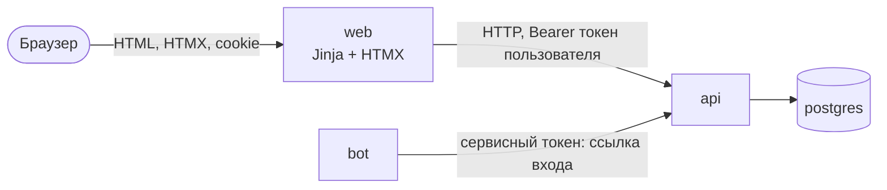

# 009. Веб-кабинет

Статус: одобрена · 03.11.2026 · сделана, ждёт чеклиста автора ([roadmap](../roadmap.md) §9)

## 1. Цель

Человек открывает в браузере `http://127.0.0.1:8080` и проходит те же сценарии, что в боте: вакансия → правка
уровня → выбор тем → тренировка текстом и голосом с видимым статусом обработки → оценка → сводка → прогресс →
повторение слабых тем → удаление своих данных. Войти можно двумя способами: по одноразовой ссылке из бота (это
тот же пользователь, что в Telegram, с той же историей) или кнопкой «Войти без Telegram» — тогда Telegram не нужен
вовсе и весь путь работает при выключенном интернете.

Веб — тонкий клиент, как бот: он рисует страницы и ходит только в API. Своих таблиц, Redis, правил прогресса и
оценки у него нет.

Вход из прошлых спринтов (roadmap §9, 000 §4.7, §5 «Приватность», §8, 008 «Итоги»):

| Что | Чем закрывается | Раздел |
|---|---|---|
| WEB-1: Jinja + HTMX через тот же API | `apps/web`, сервис `web` в compose, тест «веб не импортирует API и core» | §4, §12 |
| WEB-2: С1–С6 в браузере, голос через MediaRecorder | страницы §6, запись §7 | §6, §7 |
| WEB-3: вход по ссылке из бота и локальный вход | токены пользователя в API, `/web` в боте | §5 |
| 000 §8: «пользовательская авторизация появится вместе с веб-кабинетом» | токен пользователя + проверка владельца в API | §5 |
| 000 §5: офлайн-сценарий — веб-кабинет | демо при выключенном интернете | §10 |
| BOT-6 для веба: статус без зависаний | опрос статуса ответа и таймер у долгих операций | §8 |
| непройденный чеклист 008 | входит в общий чеклист автора в «Итогах» | §13 |

## 2. Границы

**Входит:**
- `apps/web`: FastAPI + Jinja2 + HTMX, сервис `web` в compose, порт `127.0.0.1:${WEB_PORT:-8080}`;
- сценарии в браузере: вакансия текстом, ссылкой или файлом HTML; профиль, правка уровня и удаление лишних
  требований (VAC-4); выбор тем и числа вопросов; тренировка; ответ текстом и голосом; оценка с расшифровкой,
  баллами по критериям, упущенным, советом, сомнениями распознавания и ссылками «что почитать»; пропуск вопроса;
  сводка; прогресс; повторение слабых тем; удаление голоса или всего;
- продолжение тренировки, начатой в боте (и наоборот): сессии хранятся в API, веб их просто показывает;
- в API: токены пользователя, одноразовые ссылки входа, локальный вход, проверка «ресурс принадлежит
  пользователю», список вакансий пользователя;
- в боте: команда `/web` — ссылка и короткий код входа;
- README: как открыть веб, вход, офлайн-режим, порт только на этом компьютере; `.env.example`;
- обновление 000 (§4.7, §6, §8), roadmap, CLAUDE.md.

**Не входит:**
- регистрация, пароли, вход через внешние сервисы, несколько локальных профилей;
- доступ к вебу из локальной сети или интернета (HTTPS, домен) — порт только на `127.0.0.1`, как у API;
- склейка локального профиля с Telegram-профилем (если человек сначала занимался без Telegram, потом в боте —
  это два разных пользователя);
- красивый дизайн и мобильная вёрстка сверх «читается на ноутбуке»; без JS-фреймворков и сборки фронтенда;
- функции буфера (подробный разбор по кнопке, генерация пачками) — спринт 10;
- исследовательские эндпоинты `/admin/*` в вебе.

## 3. Отклонения от roadmap и 000

1. **Статус ответа веб получает опросом API, а не событием из Redis** (ANS-3 для бота). Условие спринта — веб
   ходит только в API. Браузер раз в 2 с спрашивает у веба фрагмент статуса, веб — `GET /answers/{id}`. Для
   одного пользователя на `127.0.0.1` это ничего не стоит, а после перезагрузки страницы статус не теряется.
2. **Ссылка из бота — плюс короткий код.** Ссылка ведёт на `127.0.0.1`, то есть открывается только на том
   компьютере, где запущен Sobesnik. Если Telegram открыт на телефоне, ссылка там не сработает — поэтому в
   сообщении есть ещё код из 8 символов, который вводится на странице входа (§5.2).
3. **Ссылки на вакансию hh.ru офлайн не работают** — это ожидаемо; в офлайн-демо вакансия вставляется текстом
   или файлом HTML (VAC-1 это уже допускает).

## 4. Устройство

- `apps/web/src/sobesnik_web/`: `app.py` (сборка FastAPI, как у API — без побочных эффектов при импорте),
  `api.py` (свой тонкий клиент API на httpx и свои модели ответов — как у бота; бот не импортируется),
  `routes.py`, `auth.py` (cookie), `render.py` (тексты ошибок и подписи), `templates/`, `static/`.
- HTMX и скрипт записи лежат в `static/` (HTMX скачивается один раз в репозиторий, фиксированная версия). Никаких
  CDN и внешних шрифтов: страница целиком грузится без интернета.
- Образ — тот же `runtime`; команда `uvicorn sobesnik_web.main:app --no-access-log` (в пути страницы входа есть
  секрет, его нельзя писать в лог). Свой лог — JSON, без текстов ответов, расшифровок, cookie и токенов.
- Состояния у веба нет: кто вошёл — из cookie, где идёт тренировка — из адреса страницы (`/sessions/{id}?q=3`).
  Перезапуск `web` ничего не теряет.
- Таймаут клиента к API — 150 с, как у бота: разбор и генерация идут синхронно (~30–40 с).

## 5. Вход и авторизация в API

### 5.1. Как веб авторизуется в API

Сейчас в API два токена: сервисный (бот: доступ к данным **любого** пользователя по `user_id`) и админский.
Отдавать вебу сервисный токен и проверять «чьё это» в самом вебе — плохо: любая ошибка в вебе открывает чужие
данные, а проверка владельца — это логика, которой место в API.

Поэтому (вопрос 1, рекомендую А):
- API выдаёт **токен пользователя** — случайная строка 32 байта; в БД лежит только её SHA-256. Веб хранит токен
  в cookie браузера (`HttpOnly`, `SameSite=Lax`, путь `/`) и передаёт в API как `Authorization: Bearer …`;
- API по токену находит пользователя и **сам проверяет владельца**: вакансия, сессия, ответ, прогресс и `/forget`
  только свои. Чужое — `404 not_found`, как будто его нет (не выдаём, что такой id существует);
- `user_id` в теле запросов с токеном пользователя можно не передавать — берётся из токена; если передан чужой —
  `404`;
- сервисный токен работает как раньше — бот не меняется, кроме `/web`. Если сервисный токен не задан и запрос
  без токена — как сейчас, полный доступ (API на `127.0.0.1`, 008 решение 3);
- токен пользователя живёт 30 дней с последнего захода (`WEB_SESSION_DAYS`); «Выйти» отзывает текущий,
  «Выйти везде» — все токены пользователя.

Сервисный токен вебу нужен только для одного вызова — локального входа (§5.3).

### 5.2. Вход по ссылке из бота

1. В боте `/web` → бот вызывает `POST /auth/links {user_id}` с сервисным токеном → API создаёт одноразовую
   ссылку и короткий код, прошлые неиспользованные ссылки этого пользователя гасит.
2. Бот присылает сообщение без превью страницы:
   «Вход в веб-кабинет на этом компьютере: http://127.0.0.1:8080/login/<секрет>. Если Telegram на телефоне —
   открой http://127.0.0.1:8080/login на компьютере и введи код K7MQ-2XDA. Ссылка и код работают один раз,
   10 минут».
3. Открытие ссылки **не входит сразу**: страница «Войти в Sobesnik?» с кнопкой «Войти» (POST). Так ссылку не
   «съест» предпросмотр Telegram или браузера, который открывает адрес сам.
4. По кнопке веб вызывает `POST /auth/links/redeem {secret}` (или `{code}`), получает токен, ставит cookie.

**Если ссылку переслали другому человеку:**
- ссылка ведёт на `127.0.0.1` — на чужом компьютере она открывает его собственный компьютер, где этого Sobesnik
  нет; если у него свой Sobesnik — там такого секрета нет, будет «Ссылка недействительна»;
- ссылка одноразовая и живёт 10 минут: если владелец уже вошёл, переслать нечего; новая `/web` гасит старую;
- если кто-то всё-таки вошёл первым (сидит за тем же компьютером) — владелец увидит «ссылка уже использована»,
  возьмёт новую `/web` и нажмёт «Выйти везде» в вебе: чужой вход отзывается;
- вопрос 3: нужно ли вдобавок сообщение в бот «Выполнен вход в веб» с кнопкой «Выйти везде».

Код из 8 символов (алфавит без похожих букв, ~40 бит) за 10 минут не подобрать; на всякий случай веб после
5 неверных кодов подряд отвечает на ввод кода не чаще раза в 5 с.

### 5.3. Локальный вход без Telegram

- На странице входа кнопка «Войти без Telegram» (видна, если `WEB_LOCAL_LOGIN=true`, по умолчанию включено).
- Веб вызывает `POST /auth/local` с сервисным токеном → API находит или создаёт **локального пользователя**
  (без `telegram_id`, один на инстанс) и выдаёт токен.
- Пароля нет: веб слушает только `127.0.0.1`, значит, войти может только тот, кто сидит за этим компьютером, —
  он же владелец инстанса. README предупреждает: если открываете порт наружу — выключите `WEB_LOCAL_LOGIN`.
- Вопрос 2: локальный вход — отдельный профиль или тот же, что в Telegram.

Вход по ссылке тоже работает офлайн: cookie живёт 30 дней с последнего захода, и всё это время Telegram не нужен.

## 6. Страницы

| Адрес | Что на ней |
|---|---|
| `/login`, `/login/{secret}` | вход: кнопка «Войти без Telegram», поле кода; подтверждение входа по ссылке |
| `/` | предупреждение, если LLM недоступна (`/health/llm` с подсказкой, как в боте); новая вакансия: текст, ссылка или файл `.html`; мои вакансии; незаконченная тренировка — «Продолжить»; последние сессии |
| `/vacancies/{id}` | профиль: должность, уровень (кнопки, HTMX), стек, требования с «удалить»; темы галочками и число вопросов 3–15; «Начать тренировку» |
| `/sessions/{id}?q=N` | вопрос N из M; ответ текстом (до 5 000 символов) или голосом; «Пропустить» (показывает ссылки «что почитать», как в боте); после оценки — «Следующий вопрос»; после последнего — сводка (`/finish`) |
| `/answers/{id}` (фрагмент) | статус обработки и результат, см. §8 |
| `/progress` | темы: средний балл, попытки, слабые выделены, «мало данных» до 2 попыток, ссылки «что почитать»; последние сессии со ссылками на них; «Повторить слабые темы» (`/repeat`) |
| `/data` | «Удалить голосовые и расшифровки» / «Удалить всё» с подтверждением и итогом «Удалено …»; «Выйти», «Выйти везде» |

Тексты (итог «балл примерный, ±20», «мало данных», ошибки и подсказки) — те же по смыслу, что в боте; у веба свой
`render.py`, бот не импортируется.

Защита форм: cookie `SameSite=Lax` не уходит с чужих сайтов в POST, плюс веб отклоняет POST с чужим `Origin`.
Jinja экранирует всё по умолчанию; текст вакансии, ответа и оценки модели в HTML не исполняется.

## 7. Голос в браузере

- Кнопка «🎙 Записать» → браузер спрашивает разрешение на микрофон → идёт запись, таймер, «Стоп».
  `MediaRecorder` пишет `audio/webm;codecs=opus` (Chrome, Firefox); Safari пишет `audio/mp4` — API его тоже
  принимает (ANS-2, `m4a`). На 5:00 запись останавливается сама (лимит ANS-2).
- После «Стоп» — плеер: «Отправить» или «Записать заново» (решение 4).
- Отправка: `fetch` multipart на веб → веб передаёт файл в
  `POST /sessions/{id}/questions/{qid}/answer/voice` как есть, на диск не пишет, в лог не пишет.
- Запасной путь: «Загрузить файл» (ogg, webm, mp3, wav, m4a) — если микрофон недоступен.
- Микрофон в браузере работает только на «безопасном» адресе: `http://127.0.0.1` и `http://localhost` им
  считаются. Если доступа нет — понятный текст «Разреши микрофон в настройках браузера или загрузи файл».

## 8. Статус без зависаний (как BOT-6)

**Ответ.** Сразу после отправки (≤ 2 с) на месте формы появляется блок статуса, и браузер раз в 2 с обновляет его
(HTMX `hx-trigger="load delay:2s"`, пока статус не конечный):
- голос: «🎧 Распознаю речь…» → «🧠 Оцениваю ответ…» + расшифровка («Вот что я услышал») → результат;
- текст: сразу «🧠 Оцениваю ответ…» → результат;
- рядом счётчик секунд; после 60 с — «Модель думает дольше обычного, ответ сохранён»; можно закрыть вкладку и
  вернуться — статус продолжится с того же места;
- `failed` — текст ошибки вместо статуса («Не удалось распознать — запиши ещё раз или ответь текстом»), опрос
  прекращается.

**Долгие синхронные операции** (разбор вакансии ~30–40 с, генерация вопросов ~30 с): кнопка блокируется (без
двойной отправки), рядом «Разбираю вакансию… 12 с (обычно 30–40 с)» с живым счётчиком. Если API не ответил за
150 с или LLM недоступна — понятный текст с подсказкой из API, а не пустая страница.

## 9. API-контракт (новое и изменённое)

Токены: `S` — сервисный, `U` — пользователя, `—` — без токена.

| Метод и путь | Токен | Тело / ответ |
|---|---|---|
| `POST /auth/links` | S | `{user_id}` → `201 {secret, code, expires_at}`; прошлые неиспользованные ссылки пользователя гаснут |
| `POST /auth/links/redeem` | — | `{secret}` или `{code}` → `200 {token, user_id, expires_at}`; использована, истекла, не найдена — `404 link_invalid` (одинаково, чтобы не подсказывать) |
| `POST /auth/local` | S | `{}` → `200 {token, user_id, expires_at}`; `WEB_LOCAL_LOGIN=false` — `404` |
| `GET /auth/me` | U | `{user_id, telegram: bool, local: bool}` |
| `DELETE /auth/session` | U | отозвать текущий токен → `204` |
| `DELETE /auth/sessions` | U | отозвать все токены пользователя → `204` |
| `GET /users/{id}/vacancies` | S, U | `[{id, title, level, created_at}]`, новые сверху, до 20 |
| все клиентские эндпоинты 000 §8 | S, U | с `U` — только свои ресурсы, чужие — `404`; `user_id` в теле необязателен |

Секрет и код передаются в теле, а не в пути API: в логах API их не будет.

**Схема БД** (миграция `0007_auth`):
- `auth_token`: `id`, `user_id` (FK `users`, `ON DELETE CASCADE`), `kind` (`link|session`), `token_hash` (unique),
  `code_hash` (unique, null — только у ссылки), `created_at`, `expires_at`, `used_at` (null), `last_used_at` (null),
  `revoked_at` (null). `last_used_at` и продление срока сессии пишутся не чаще раза в час.
- `users.local` (bool, по умолчанию `false`, частичный unique-индекс по `true`) — локальный пользователь (§5.3).

Проверка владельца — одна зависимость `Caller` (`user_id` или «сервис») и аргумент `owner` в существующих
`get_vacancy`, `get_session`, `get_answer` и прогрессе. Ответы датасета (`user_id = null`) с токеном пользователя
недоступны.

## 10. Запуск, compose, README, офлайн

- `compose.yaml`: сервис `web` (образ `runtime`, `depends_on: api healthy`, `restart: unless-stopped`), порт
  `127.0.0.1:${WEB_PORT:-8080}:8000`, healthcheck как у `api`.
- Переменные (в `.env.example` с комментариями): `WEB_PORT` (8080), `WEB_PUBLIC_URL` (по умолчанию
  `http://127.0.0.1:8080` — из него бот строит ссылку), `WEB_LOCAL_LOGIN` (`true`), `WEB_SESSION_DAYS` (30).
  `API_URL` и `API_SERVICE_TOKEN` веб берёт те же, что бот.
- `TELEGRAM_BOT_TOKEN` перестаёт быть обязательным: без него бот не стартует (как сейчас, код 0), а веб работает.
  README: «Без Telegram: оставьте токен пустым и откройте http://127.0.0.1:8080 → Войти без Telegram».
- README, раздел «Веб-кабинет»: адрес, два способа входа, порт только на этом компьютере (как API) и как его
  поменять, микрофон, офлайн-режим, «если не открывается».
- **Офлайн.** Перед демо проверю, что воркер стартует и распознаёт без сети: сейчас он при старте спрашивает у
  Hugging Face ревизию модели (008 «Итоги»). Если без сети он ждёт или падает — whisper сначала грузится из тома
  без сети (`local_files_only`), и только если модели там нет — качается.

## 11. Тесты

Без Ollama, Telegram, сети и браузера.
- API, авторизация: выдача ссылки сервисным токеном; погашение по секрету и по коду; повторное погашение,
  истёкшая ссылка и новая `/web` гасят старую — `404 link_invalid`; локальный вход создаёт одного пользователя и
  при повторе возвращает того же; выключенный локальный вход — `404`; выход и «выйти везде»; истёкший токен — `401`;
  в БД нет токенов в открытом виде.
- API, владелец: с токеном пользователя чужие вакансия, сессия, ответ, прогресс, `/forget` — `404`; свои — как
  раньше; `user_id` берётся из токена; сервисный токен по-прежнему видит всех (тесты бота не меняются).
- Веб (клиент API — фейк через свой `Protocol`, как у бота): страницы входа, cookie ставится и снимается; без
  cookie — редирект на `/login`; страницы §6 рендерятся с данными фейка; статус ответа по всем статусам, в том
  числе «дольше 60 с» и `failed`; отправка голоса передаёт файл в API без изменений; POST с чужим `Origin` — `403`;
  ошибки API показываются текстом с подсказкой.
- Веб не тянет логику: тест проверяет, что `sobesnik_web` не импортирует `sobesnik_api`, `sobesnik_core`,
  `sqlalchemy`, `redis`, `arq`.
- Бот: `/web` вызывает API и шлёт ссылку и код без превью; ошибка API — понятный текст.
- `.env.example` ↔ настройки веба (как `tests/test_deploy.py`).

## 12. Проверка вживую (сам, без автора)

Через API, логи и встроенный браузер на рабочем инстансе; на живой модели — только быстрые проверки, после —
`ollama stop qwen3.5:4b`.
1. Локальный вход → вакансия текстом → уровень → 2 темы, 3 вопроса → ответ текстом → оценка → «Пропустить» →
   сводка → прогресс → «Повторить» → `/forget` всё.
2. Голос: во встроенном браузере нет микрофона — отправляю фрагмент из `research/data/asr_check` через «Загрузить
   файл»; запись микрофоном — в чеклисте автора.
3. Вход по ссылке: ссылку беру из `POST /auth/links` (как это сделает бот), проверяю повтор и «Выйти везде».
4. Офлайн: Wi-Fi на Маке сам не выключаю. Отрезаю контейнеры от внешней сети (Ollama на хосте остаётся доступна),
   перезапускаю воркер и прохожу п. 1–2; в «Итогах» пишу, что именно так проверено. Выключенный Wi-Fi —
   пункт чеклиста автора.
5. Логи `web` и `api`: нет текстов ответов, расшифровок, токенов, секретов ссылок.

## 13. Порядок работы

1. API: `auth_token`, `users.local`, `/auth/*`, `Caller` и проверка владельца, список вакансий + тесты → коммит.
2. `apps/web`: каркас, вход, cookie, compose, `.env.example` + тесты → коммит.
3. Страницы вакансии и тренировки, статус ответа, голос + тесты → коммит.
4. Прогресс, повторение, `/data` + тесты → коммит.
5. Бот: `/web` + тесты → коммит.
6. Офлайн-старт воркера (если нужно), README, 000, CLAUDE.md → коммит.
7. Проверка вживую §12, фиксы → коммиты; `ollama stop`.
8. «Итоги» и **один общий чеклист автора**: веб (запись с микрофона, вход по ссылке с телефона кодом, офлайн с
   выключенным Wi-Fi) + непройденный чеклист 008 (бот в Telegram, п. 1–11). Push — только по команде автора.

## 14. Критерии приёмки спринта

1. С1–С6 проходятся в браузере после локального входа; голос — файлом (сам) и микрофоном (чеклист автора).
2. Вход по ссылке из бота даёт того же пользователя, что в Telegram: тренировка, начатая в боте, видна и
   продолжается в вебе.
3. С токеном пользователя чужие данные недоступны (тесты §11); веб не импортирует API, core, БД и Redis.
4. Статус ответа меняется без перезагрузки страницы и переживает её; долгие операции показывают счётчик.
5. С1–С5 в браузере работают без интернета (Ollama на хосте, whisper из тома) — проверено мной без сети в compose
   и автором с выключенным Wi-Fi.
6. Порт веба только на `127.0.0.1`; README описывает вход и офлайн-режим.
7. `pytest`, `ruff check`, `ruff format --check`, `mypy` зелёные.

## 15. Открытые вопросы

1. **Как веб ходит в API.** А — API выдаёт вебу токен конкретного пользователя и сам проверяет, что вакансия,
   сессия и ответ принадлежат ему (§5.1); ошибка в вебе не откроет чужое. Б — веб ходит с сервисным токеном, как
   бот, и сам следит, чтобы человек видел только своё: быстрее на день, но в API остаётся «кто знает id — видит
   всё». *Рекомендую А.*
2. **Кто входит кнопкой «Без Telegram».** Пример: вы занимались в боте, потом выключили интернет и нажали
   «Войти без Telegram». А — это отдельный «локальный» профиль: прогресса из бота там нет (его видно, если хоть раз
   войти по ссылке — cookie живёт 30 дней и офлайн). Б — если на инстансе ровно один Telegram-пользователь, кнопка
   входит в него, и прогресс общий; если пользователей несколько — отдельный профиль, как в А. *Рекомендую А:*
   проще и не зависит от того, сколько людей пользуется ботом.
3. **Переслали ссылку.** А — защиты из §5.2 хватает: ссылка на `127.0.0.1` у другого человека не откроется, она
   одноразовая и на 10 минут, а в вебе есть «Выйти везде». Б — вдобавок после каждого входа бот пишет «Выполнен
   вход в веб-кабинет 14:02. Не вы? [Выйти везде]» (+ новое событие API → бот). *Рекомендую А.*
4. **Запись голоса.** Пример: вы нажали «Стоп» и поняли, что сбились. А — после «Стоп» появляется плеер:
   «Отправить» или «Записать заново». Б — как в Telegram: «Стоп» сразу отправляет. *Рекомендую А.*

## 16. Решения по открытым вопросам

1. **Как веб ходит в API** — токен пользователя, владельца проверяет API (ответ автора: А, §5.1).
2. **Вход без Telegram** — отдельный локальный профиль, один на инстанс (ответ автора: А, §5.3).
3. **Переслали ссылку** — одноразовая ссылка на 10 минут на `127.0.0.1`, вход по кнопке, «Выйти везде» в вебе;
   уведомления о входе в бот нет (ответ автора: А, §5.2).
4. **Запись голоса** — после «Стоп» плеер: «Отправить» или «Записать заново» (ответ автора: А, §7).

## Итоги

03.11.2026. Сделано всё из §2: API с токенами пользователя и проверкой владельца, `apps/web` (Jinja + HTMX, ходит
только в API), `/web` в боте, README и `.env.example`. 669 тестов, `ruff check`, `ruff format --check`, `mypy`
зелёные. Push не делался.

**Как проверено вживую** (Mac M4 16 ГБ, `qwen3.5:4b`, whisper `small`, встроенный браузер, по одному прогону):

| Что | Результат |
|---|---|
| локальный вход → вакансия текстом | профиль за ~25–30 с |
| уровень → Senior (HTMX, без перезагрузки) | ✅ |
| 2 темы, 3 вопроса | готовы за ~20–30 с |
| ответ текстом | статус «Оцениваю ответ…» со счётчиком секунд, оценка через ~30 с без перезагрузки страницы |
| ответ голосом | фрагмент `v01` из `research/data/asr_check` отправлен в тот же адрес, что и запись из браузера: «🎧 Распознаю речь…» → оценка через ~30 с, расшифровка и сомнения в распознавании видны |
| «Пропустить вопрос» | ссылки «что почитать» под пропуском |
| сводка → прогресс → «Повторить» → ответ | «Отвечено 2 из 3 · зачтено 1»; повторение по слабой теме; после ответа прогресс пересчитан (asyncio: 2 попытки) |
| «Мои данные» | «Только голос»: удалено 1 запись и 1 расшифровка; «Всё»: вакансия, 3 ответа — удалены |
| вход по ссылке (`POST /auth/links`, как бот) | тот же пользователь, что в Telegram: его 4 вакансии, прогресс по 4 темам, законченная в боте сессия открывается сводкой; чужая сессия — 404 |
| повтор ссылки, код после погашения ссылки | отказ «Ссылка или код недействительны» |
| код строчными и без дефиса | вход ✅; после 5 неверных подряд — 429 «подождите» |
| «Выйти» / «Выйти везде» | выход; «везде» закрывает другие входы того же человека, локальный вход не задевает |
| POST с чужим `Origin` | 403 |
| логи `web`, `api`, `worker` | только id, статусы и счётчики; нет текстов ответов, расшифровок, токенов `sbu_`, секретов ссылок; у `web` нет access-лога |

**Офлайн.** Wi-Fi не выключал (§12 п. 4): `api`, `worker`, `postgres`, `redis`, `s3` — во внутренней сети
Docker без выхода наружу (`internal: true`); к Ollama на хосте — через TCP-прокси с сетевым именем
`host.docker.internal` (иначе Ollama отвечает 403 на чужой `Host`). Весь путь выше, кроме входа по ссылке,
пройден так. Оверлей и прокси — во временной папке, в репозиторий не входят; после проверки стек поднят обычным
`docker compose up -d`, бот запущен, `ollama stop`.

**Что выяснилось:**
- whisper без сети грузится из тома сам: `download_model` не достучался до Hugging Face и за 0,3 с взял модель
  с диска (`asr model ready`). Правка из §10 («сначала `local_files_only`») не понадобилась.
- Кнопка «⏹ Стоп» была видна до начала записи: стиль кнопок перебивал атрибут `hidden`. Исправлено.
- «Пропустить вопрос» оставался под оценкой после ответа через HTMX — перенесён в форму ответа.
- После пересборки браузер брал старый CSS из кэша — ссылки на статику теперь с `?v=хэш`.
- Подтверждения «Удалить…» — родные окна браузера (`hx-confirm`); во встроенном браузере их не нажать,
  для проверки подменял `confirm` скриптом. Вживую — п. 4 чеклиста.

**Не проверено мной:** запись с микрофона (во встроенном браузере его нет — голос шёл файлом), вход по коду с
телефона, работа с выключенным Wi-Fi, Safari (запись в mp4). Всё это — в чеклисте ниже.

## Чеклист автора (общий: веб + непройденный 008)

Рабочий инстанс уже поднят (`docker compose up -d --build` выполнен, бот запущен). Время отмечать не нужно —
Claude возьмёт его из логов. Найденное пишите номером пункта: «3 — не появился плеер».

**Веб-кабинет** — http://127.0.0.1:8080 в Chrome:
1. ☐ «Войти без Telegram» → вставить текст вакансии → профиль; поменять уровень.
2. ☐ «Начать тренировку» → ответить **голосом с микрофона**: «🎙 Записать» → браузер спросит микрофон →
   «⏹ Стоп» → плеер → «Записать заново» → снова «Стоп» → «Отправить запись». Видна расшифровка, потом оценка.
3. ☐ То же в Safari (по желанию): запись должна отправиться (Safari пишет в mp4).
4. ☐ «Мои данные» → «🎙 Только голос» → окно «Удалить…?» → «ОК» → «Удалено записей: …».
5. ☐ **Без интернета:** выключить Wi-Fi → обновить страницу → новая вакансия текстом → 1 вопрос → ответ голосом →
   оценка. Включить Wi-Fi.
6. ☐ В боте `/web` → открыть ссылку на этом компьютере → «Войти» → видны вакансии и прогресс из бота.
7. ☐ Ещё раз `/web` → на странице входа ввести **код** с телефона → вход. Та же ссылка второй раз — «недействительна».

**Бот в Telegram** (чеклист 008, не пройден):
8. ☐ `/start` — инструкция (есть строка про `/web`), без предупреждения о модели.
9. ☐ Ссылка на вакансию hh.ru — профиль за ~30–40 с; поменять уровень кнопкой.
10. ☐ «🎯 Выбрать темы» → 2–3 темы → 3 вопроса → «Начать»; закрыть и открыть выбор снова — отметки на месте.
11. ☐ Ответ текстом — статус приходит сразу, оценка через 15–30 с.
12. ☐ Голосовое ~1 минута — видна расшифровка, потом оценка. Пока оценивается — Claude перезапускает бота
    (`docker compose restart bot`), оценка приходит после перезапуска.
13. ☐ «Пропустить» — под пропуском ссылки «что почитать».
14. ☐ Сводка в конце сессии.
15. ☐ `/progress` → `/repeat` → ответить на один вопрос.
16. ☐ `/forget` → удалить всё → «Удалено …»; `/progress` пуст.
17. ☐ (по желанию) Выключить Ollama → `/start` — предупреждение «Не достучался до Ollama»; включить обратно.
18. ☐ README глазами: понятно ли «с нуля» и раздел «Веб-кабинет», нет ли лишнего.

После: Claude смотрит логи (`ack_ms`, разбор, генерация, оценка, нет текстов и токенов), `ollama stop`, дописывает
⏳ в 008 «Итоги» и здесь; `v0.1.0` уже стоит, push — только по команде.
